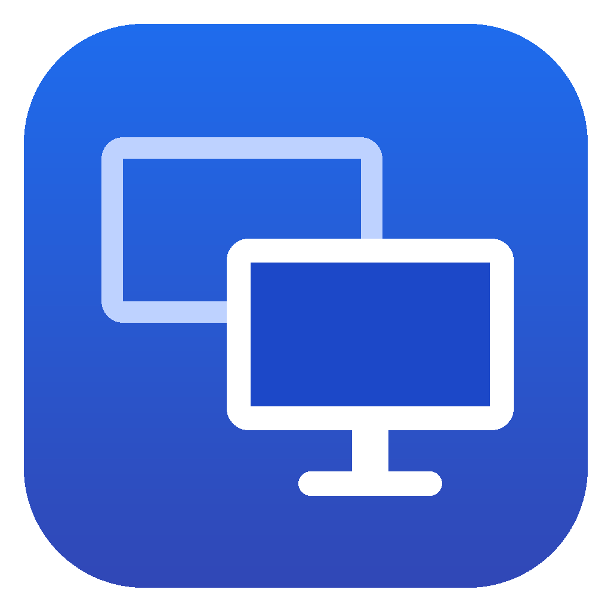

<p align="center">
  
</p>

<h1 align="center">Annex</h1>

<p align="center">
  Use a Windows PC's monitors as extra displays for your Mac, over your local network.
</p>

<p align="center">
  <a href="https://github.com/msadiks/annex-app/releases/latest"></a>
  <a href="https://github.com/msadiks/annex-app/actions/workflows/ci.yml"></a>
  <a href="#licence"></a>
</p>

Annex behaves like a cable would, minus the cable: turn a PC monitor on in
Annex and the Mac sees a new display; turn it off and the display is
unplugged. It's free and open source, and it works entirely on your own
network, with no account, cloud service or relay.

- **Sharp** mode sends exact colour (4:4:4) for text and UI, **Fast** mode is
  plain 4:2:0 for video and motion. The first display gets Sharp, others Fast,
  and you can pin either per monitor.
- Up to three PC monitors at once, each as its own Mac display, or mirroring a
  Mac display.
- Hardware HEVC on both ends (VideoToolbox on the Mac, D3D11VA on the PC),
  forward error correction, and encryption for everything on the wire.
- LAN only. Nothing leaves your network.

## Project status

Annex 1.0 is the first public release. It has only been tested on a handful of
machines so far, so expect rough edges on other hardware, and please
[report what you find](https://github.com/msadiks/annex-app/issues/new/choose).
Results from GPUs and Macs we haven't tried are one of the most useful
contributions right now.

## Requirements

- **Mac:** Apple silicon, macOS 13 or later.
- **PC:** Windows 10 or 11, 64-bit, with a GPU that decodes HEVC (NVIDIA GTX
  950 / AMD RX 400 / Intel 6th gen or newer). The Annex window uses the
  Microsoft Edge WebView2 Runtime, which Windows 11 and up-to-date Windows 10
  already have; without it Annex still runs from the tray and offers the
  download.
- Both on the same network. Wired Ethernet on at least one side gives the
  lowest latency; 5 GHz Wi-Fi works.

## Install and connect

1. From the [latest release](https://github.com/msadiks/annex-app/releases/latest),
   download `Annex-mac-arm64.dmg` for the Mac and, for the PC, either
   `Annex-windows-x64-setup.exe` (installer) or
   `Annex-windows-x64-portable.zip` (no install).
2. **PC:** run the installer, or unzip the portable folder anywhere (a USB
   stick works) and run `Annex.exe` in it. The Annex window opens, and Annex
   also lives in the system tray (the monitor icon).
   - Windows may show a SmartScreen warning for a new app: choose
     *More info → Run anyway*.
   - The installer asks for admin once and adds a Windows Firewall rule for
     Annex: private networks, plus public networks for devices on your local
     subnet only. Annex uses TCP 48800 and UDP 48801.
   - The portable copy has no installer, so allow it when Windows Firewall
     asks. If the firewall still blocks the Mac (for example on a network
     Windows marks *Public*), the Annex window shows a banner with a button
     to fix it.
   - The portable copy keeps its settings and logs in a `data` folder next to
     `Annex.exe` and writes nothing else to the PC.
3. **Mac:** open the .dmg and drag Annex to Applications, then open it. It
   lives in the menu bar.
   - Allow **Screen Recording** when macOS asks (System Settings › Privacy &
     Security › Screen Recording), then quit and reopen Annex.
   - Allow **Local Network** access when asked.
4. **Pair once:** in the Annex window on the PC choose *Pair with your Mac*
   (or *Pair with a Mac…* in the tray menu). A PIN appears on the PC. Type it
   into the Annex window on the Mac (menu bar icon › *Open Annex…*; it opens
   by itself until you've paired).
5. **Plug in a monitor:** turn a monitor on in the Annex window on either side
   (or tick it in the PC tray menu). Within a second the Mac shows a new
   display. Arrange it in System Settings › Displays like any other monitor.

From then on both apps reconnect by themselves whenever they're on the same
network. Turn on *Start with Windows* on the PC and *Start at login* on the
Mac to make it permanent.

## Everyday use

- **PC window:** left-click the tray icon (or open Annex again) to show it.
  Turn monitors on or off, pick *Mode* (Auto / Sharp / Fast) and *Source*
  (*Extend* as a new Mac display, or *Mirror* one of the Mac's displays), see
  live stats per monitor, pair or forget the Mac, and set *Start with
  Windows* and the stats overlay (also `Ctrl+Shift+F12`). Closing the window
  keeps Annex running in the tray; *Quit Annex* stops it.
- **PC tray menu:** right-click the tray icon for the same monitor settings
  in a menu.
- **Mac window:** the same per-monitor settings, live stats (frame rate,
  bitrate, loss, estimated latency), pointer drawing and login options.
- If the network drops, the Mac keeps the display for 30 seconds so your
  windows don't move. After that it's unplugged until the PC is back.

## Troubleshooting

- **The Mac can't find the PC:** both must be on the same subnet, and Windows
  Firewall must let Annex in. The PC's Annex window shows a yellow banner when
  it doesn't (no rule, a block rule, or a network Windows marks *Public*);
  use its button to allow Annex, or set the network to *Private* in Windows
  Settings. The tray menu shows *Windows Firewall is blocking your Mac* too.
- **Black screen on the PC:** the PC shows black when the Mac is gone for 2 s
  (no signal). Make sure the Mac app is running and Screen Recording is
  allowed.
- **macOS asks again about screen recording every month:** that's macOS's
  periodic re-confirmation for apps that capture the screen. Approve it. Known
  workarounds exist (for example the *Amnesia* app, or editing the `replayd`
  plist), but they are unsupported.
- **Logs:** PC: *Open log folder* in the Annex window or tray menu
  (`%LOCALAPPDATA%\Annex\logs`, or `data\logs` next to a portable
  `Annex.exe`). Mac: `~/Library/Logs/Annex/annex.log`. Set `ANNEX_LOG=debug`
  for more detail.
- **Reset:** delete `%APPDATA%\Annex\config.toml` on the PC (`data\config.toml`
  for the portable copy) or `~/Library/Application Support/Annex/config.toml`
  on the Mac and pair again.

Still stuck? [Open a bug report](https://github.com/msadiks/annex-app/issues/new/choose)
with both logs attached.

## How it works

The Mac creates a virtual display (or picks an existing one to mirror),
captures it with ScreenCaptureKit, packs the pixels on the GPU with Metal and
encodes HEVC with VideoToolbox. Frames travel over UDP with forward error
correction and per-packet encryption, while a TCP control channel (Noise
handshake, PIN pairing) handles discovery, stream setup and stats. The PC
decodes with FFmpeg's D3D11VA decoder and draws full screen on the chosen
monitor. The full design, including the rules every change must respect, is
in [docs/spec.md](docs/spec.md).

| Path | What it is |
| --- | --- |
| `crates/annex-proto` | Wire format, FEC, encryption, control messages, discovery, pairing. Platform independent. |
| `crates/annex-core` | Resolution rules, mode negotiation, stats, config. Platform independent. |
| `crates/annex-sender` | Sender engine: sessions, streams, packetizing and pacing. Platform independent. |
| `crates/annex-mac` | Mac capture and encode: virtual displays, ScreenCaptureKit, Metal, VideoToolbox. Also `annex-mac-cli` for testing. |
| `crates/annex-win` | Windows receiver: `Annex.exe`, its tray menu and its window (WebView2, page in `ui/`). |
| `crates/annex-testsrc` | Test sender that plays pre-encoded HEVC, so the PC side can be checked without a Mac. |
| `apps/annex-mac-app` | Mac menu bar app (Tauri 2) around `annex-mac`. |
| `tools/` | FFmpeg build, icon generation, Windows installer and packaging, Mac release script. |
| `docs/` | Design spec, measurements, release process. |

## Building from source

Everything is Rust (edition 2024). The protocol, core logic and sender engine
are platform independent and build anywhere:

```sh
cargo test -p annex-proto -p annex-core -p annex-sender
```

**Windows receiver** (`crates/annex-win`), cross-compiled from Linux (or
built in MSYS2) with mingw-w64 against a trimmed, LGPL-only static FFmpeg:

```sh
sudo apt install mingw-w64 nasm
rustup target add x86_64-pc-windows-gnu
tools/ffmpeg/build-mingw.sh            # HEVC decoder + D3D11VA only
cargo build --release --target x86_64-pc-windows-gnu -p annex-win
```

The result is a single `annex.exe` that needs only system DLLs and the
WebView2 Runtime (its loader DLL is built in). To make the installer and the
portable zip in `dist/`:

```sh
sudo apt install nsis zip
tools/windows/package.sh
```

**Mac sender** (`crates/annex-mac`) and app (`apps/annex-mac-app`, Tauri 2),
on an Apple silicon Mac:

```sh
cargo build --release -p annex-mac          # includes annex-mac-cli for testing
npm install -g @tauri-apps/cli@2
cd apps/annex-mac-app && tauri build --bundles dmg
```

**Test sender** (`crates/annex-testsrc`) plays generated HEVC test patterns
to a receiver, so the PC side can be checked without a Mac:

```sh
cargo run --release -p annex-testsrc -- gen --size 1920x1080 --mode sharp --out media
cargo run --release -p annex-testsrc -- run --addr <pc-ip> --media media --pin <PIN> --enable 0
```

Maintainers: signing and publishing a release is described in
[docs/releasing.md](docs/releasing.md).

## Contributing

Bug reports, hardware test results, documentation and code are all welcome.
Please read [CONTRIBUTING.md](CONTRIBUTING.md) before opening a pull request,
and open an issue first for anything bigger than a bug fix. Everyone taking
part is expected to follow the [Code of Conduct](CODE_OF_CONDUCT.md).

Found a security problem? Please don't open a public issue; see
[SECURITY.md](SECURITY.md).

## Licence

Annex is licensed under either of [MIT](LICENSE-MIT) or
[Apache-2.0](LICENSE-APACHE), at your option. Unless you explicitly state
otherwise, any contribution you intentionally submit for inclusion in Annex,
as defined in the Apache-2.0 licence, is dual licensed as above, without any
additional terms or conditions.

The Windows receiver statically links [FFmpeg](https://ffmpeg.org) (tag
`n8.1.3`, configured LGPL-only with just the HEVC decoder and D3D11VA; see
`tools/ffmpeg/build-mingw.sh`), which is licensed under the LGPL 2.1 or later.
